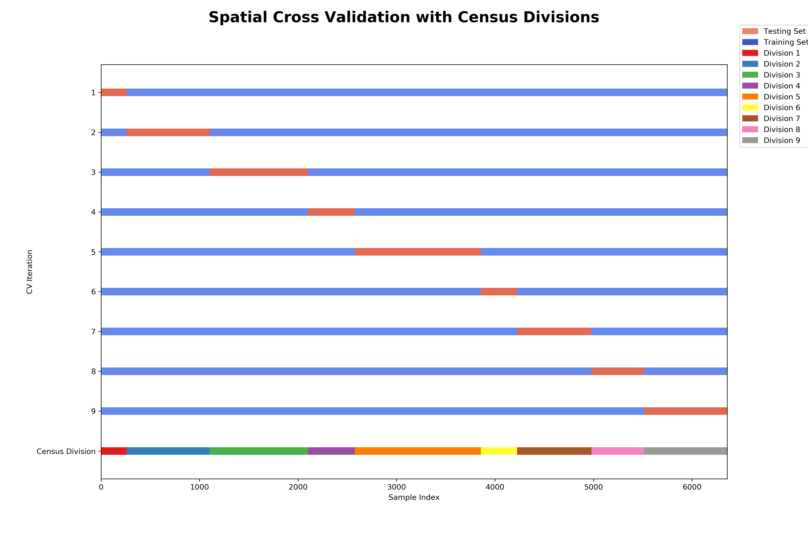
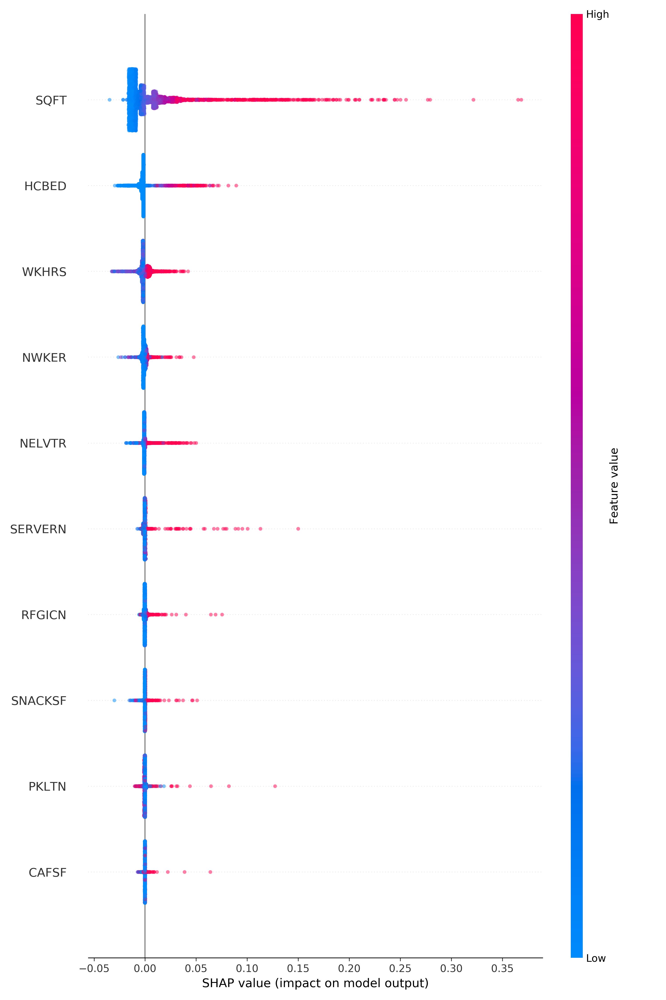

# Predicting Commercial Building Energy Use

Which building characteristics best predict how much energy a commercial building uses? And can a model trained on national data predict for a region it has never seen?

Cities are now regulating building emissions; New York's Local Law 97 is one example. That makes it useful to estimate consumption from the basic building attributes a city or a real-estate database already has.

Final project for *Machine Learning for Public Informatics*, Rutgers Bloustein School, Spring 2023. Full report: [`FINALPROJECT_SC.pdf`](FINALPROJECT_SC.pdf).

## Data

The **2018 Commercial Buildings Energy Consumption Survey (CBECS)** public-use microdata from the U.S. Energy Information Administration, as revised December 2022. It covers 6,436 sampled buildings representing 5.9 million U.S. commercial buildings. The target is total major-fuel consumption in BTUs (`MFBTU`).

## Approach

- **Two feature sets**
  - *CoStar-available:* attributes a commercial real-estate database would have, such as square footage, floors, primary activity and heating/cooling degree days.
  - *Automatically selected:* the features shared by random-forest importance and recursive feature elimination, then pruned for collinearity.
- **Target transformations:** four versions of the target (raw, log, normalized, normalized log).
- **Models:**
  - random forest, k-nearest neighbors, AdaBoost and gradient boosting, tuned with scikit-optimize
  - OLS, a gamma GLM and an SVM were also tried
- **Spatial cross-validation:** leave one Census division out, nine folds. Every score comes from a region the model never trained on, which tests transfer to a new region (the application in mind was New Jersey).
- **Metric:** mean squared logarithmic error.
- **Interpretability:** SHAP summary, dependence and force plots, partial dependence, and LIME.

**Result:** random forest with a normalized target scored best on both feature sets, with k-nearest neighbors a close second.

  
  

## Files

| Notebook | Step |
|---|---|
| [`MLPI_FINALPROJECT_SC_DATA_PREPROCESSING.ipynb`](notebooks/MLPI_FINALPROJECT_SC_DATA_PREPROCESSING.ipynb) | cleaning, transformation, train/test construction |
| [`MLPI_FINALPROJECT_SC_FEATURE_SELECTION.ipynb`](notebooks/MLPI_FINALPROJECT_SC_FEATURE_SELECTION.ipynb) | F-values, mutual information, random-forest importance, recursive feature elimination |
| [`MLPI_FINALPROJECT_SC_MODEL_SELECTION.ipynb`](notebooks/MLPI_FINALPROJECT_SC_MODEL_SELECTION.ipynb) | spatial cross-validation and hyperparameter tuning |
| [`MLPI_FINALPROJECT_SC_INTERPRETABILITY.ipynb`](notebooks/MLPI_FINALPROJECT_SC_INTERPRETABILITY.ipynb) | SHAP, partial dependence, LIME |

`images/` has every figure from the report.

The data are not included. Download the CBECS 2018 microdata from [EIA](https://www.eia.gov/consumption/commercial/data/2018/index.php?view=microdata) into `data/`.

## Stack

Python · pandas · scikit-learn · scikit-optimize · Yellowbrick · SHAP · LIME · seaborn
